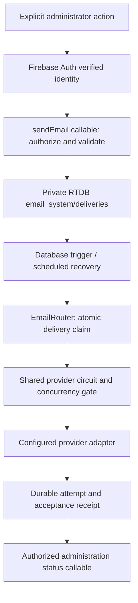

# Persistent email architecture

Implementation date: 2026-10-29. Research and constraints: [provider comparison](email-providers-research.md). Deployment is staged and disabled in the public frontend until the setup checklist is complete.

The browser supplies an explicit message request, not a provider API credential. The callable verifies Firebase Auth's verified email against server-side EMAIL_ADMIN_EMAILS. The old CU.isAdmin field and gaia_v7 records are publicly writable legacy data and are NOT authentication. Messages/recipients supplied by the verified mail administrator are validated and snapshotted into a private root; later changes to public membership/notice data cannot silently change a queued delivery. Arbitrary browser reads/writes of email_system are denied, including owner browser writes. Admin SDK uses the function runtime identity; no downloaded service-account key is needed.

Each normalized address receives one SHA-256 identity from category + entityId + normalized address. A second member with the same address does not receive another message. The content fingerprint makes conflicting attempts to reuse that identity fail. ID receipts must not be deleted to gain a resend: they are permanent deduplication evidence. Enqueueing is per-delivery atomic; interrupted batch admission can be retried with the same request to complete remaining recipients. A successful callable response confirms durable admission, not sending.

`EmailRouter` claims only `pending` deliveries with a transaction. It persists a `sending` attempt before submission, then records structured adapter outcome and provider message ID. One provider invocation makes one HTTP request; fetch has no application retry. Provider concurrency gates and circuit state also use database transactions, shared across instances and tabs. If all configured providers are temporarily unavailable, the delivery remains pending. A scheduler resumes eligible pending work; closing the portal after successful admission does not stop it. With one active provider, the 1.2s shared pacing can defer other recipients to subsequent scheduler passes. There is no throughput guarantee for large batches.

States used: pending, sending, accepted, failed, unknown. `delivered` is reserved for externally confirmed delivery, currently never set by adapters. API acceptance must not be labelled inbox arrival. quota_exceeded/rate_limited are attempt outcomes and circuit reasons; duplicate is an admission result flag, not another delivery. Invalid input is rejected before queue creation. Legacy sent receipts retain their historical meaning; the new backend does not reinterpret them as delivered.

All five small adapters (Mailjet, SMTP2GO, Resend, Brevo, EmailJS) share send/healthCheck/getStatus. Only configure the ones needed. healthCheck currently inspects configuration without a network request or email. Status is not an asserted live health check. Native Resend idempotency is additional 24h protection; permanent database identity is the primary mechanism. Brevo's limited native idempotency and Mailjet CustomID are not relied upon as durable deduplication.

## Migration boundaries

New notices can acquire a permanent `gaia_notice_routes/{id}` backend route. The new rules prevent the old browser or Apps Script from changing that route. Notices with existing legacy attempts/emailSent or an existing EmailJS/Gmail route are refused for automatic import, regardless of whether those attempts look successful. Reconcile old records manually rather than risk cross-system duplicates. The public gaia_v7 data is not a secure audit log; protected route ownership, not that public snapshot, prevents returning a backend notice to an old sender.

Events and review notifications use stable explicit event/submission-action identities through queuePortalEmail once enabled. Historical event/review sends have no reliable backend identity; do not bulk import or automatically replay them. Before cutover, close old portal sessions, inspect legacy in-flight work, disable browser EmailJS sending/rotate its public credentials, and update Apps Script if it remains in use. Do not toggle back to browser mode while jobs exist. Rollback means disable provider dispatch, keep private receipts and diagnose; not reroute uncertain jobs.

The no-automatic-browser-send fix f0fdc1608bba280a4bba6747bf12efe57b2e79fe remains intact. Login, rendering, reload, sync and browser timers never admit email. Backend scheduling only works on explicitly admitted pending messages; it does not scan the calendar for new reminders. Task reminders are future explicit products, not introduced by this migration.

## Limits and operation

At-most-once submission under uncertainty is favored over automatic completion: a crash after acceptance but before a receipt can leave a delivery unknown. This is not an exactly-once or guaranteed-delivery claim. Jobs without providers remain pending indefinitely, with no silent deletion. Manual unknown reconciliation/resend is deliberately not exposed as a one-click operation. The administrator must investigate provider history first; a future reconciliation tool must record evidence and preserve the original ID.

The dashboard returns the latest 200 private receipts this UTC month, with a bounded 10,000-record aggregate and an explicit truncation flag. It distinguishes configured, observed last acceptance, unavailable, unknown quota and proven quota exhaustion. It does not invent remaining balances, load-balance on estimated free quota or measure inbox placement. Monthly reporting uses durable current record timestamps; it is not an accounting export. Provider webhooks are evaluated in email-failover.md; no unsigned event endpoint is exposed.

The scheduled recovery admits no new messages and handles at most six due pending deliveries per minute with server-side spacing, keeping the pass bounded under provider timeouts. The database trigger handles newly admitted messages as well. Conditional RTDB transactions retain a temporary value listener so a cold SDK cache cannot be mistaken for an absent delivery; this is verified against the database emulator, not just a memory store.

Firebase Functions requires Blaze and a deployment with service identity, Secret Manager and correct RTDB location. No paid account is activated by this source change. Alternatives and compute-cost limits are documented in the research. Functions are capped at two instances (recovery scheduler one); scheduled execution, database access, build artifacts and secrets can still incur costs.
